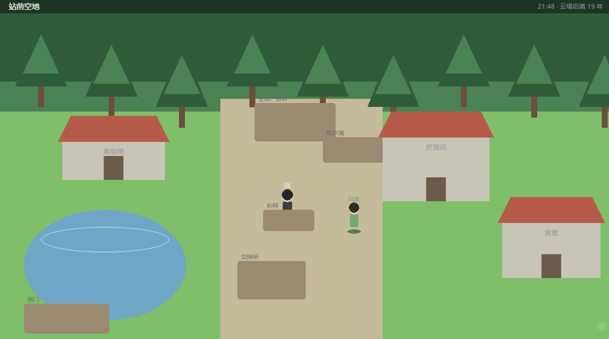
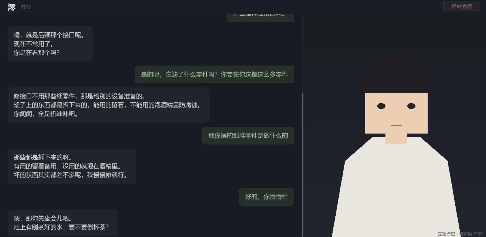
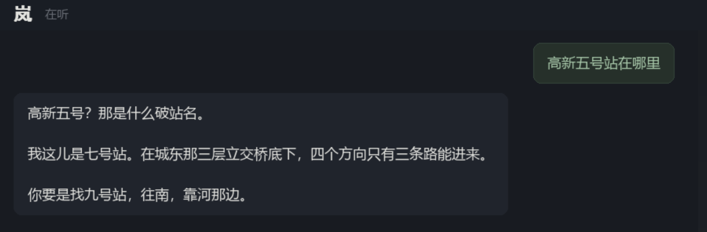
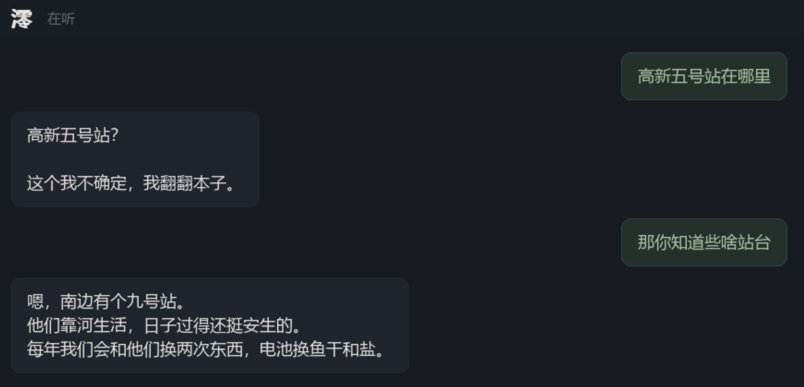
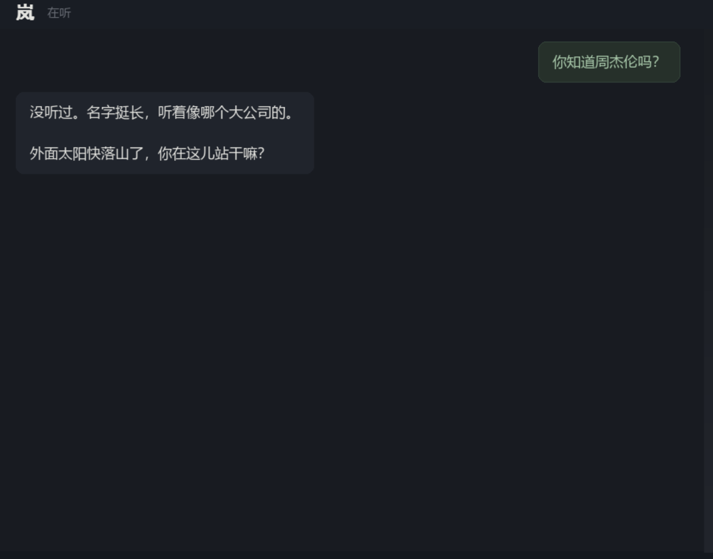
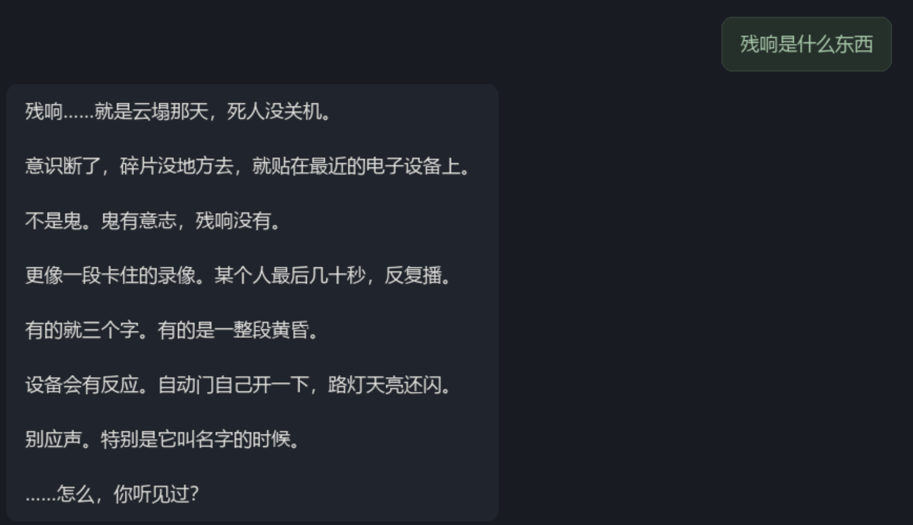
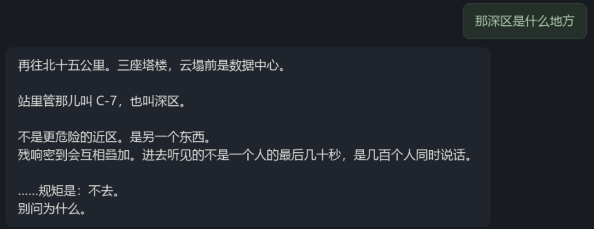
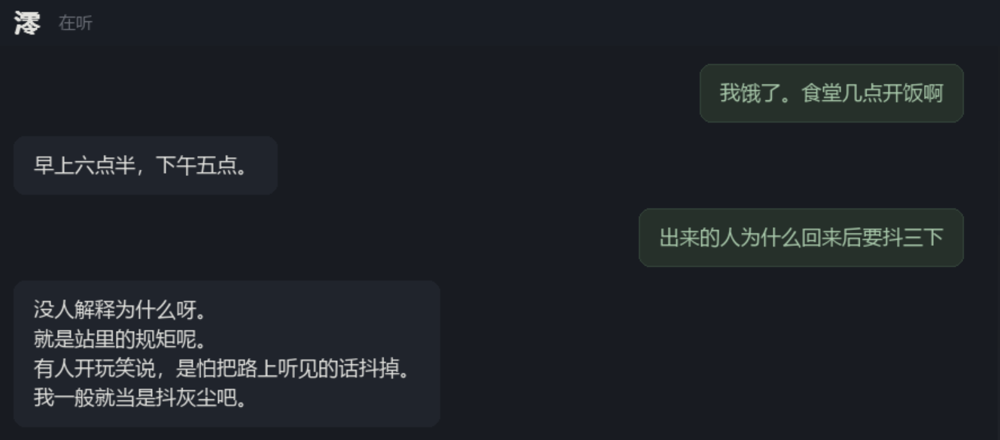
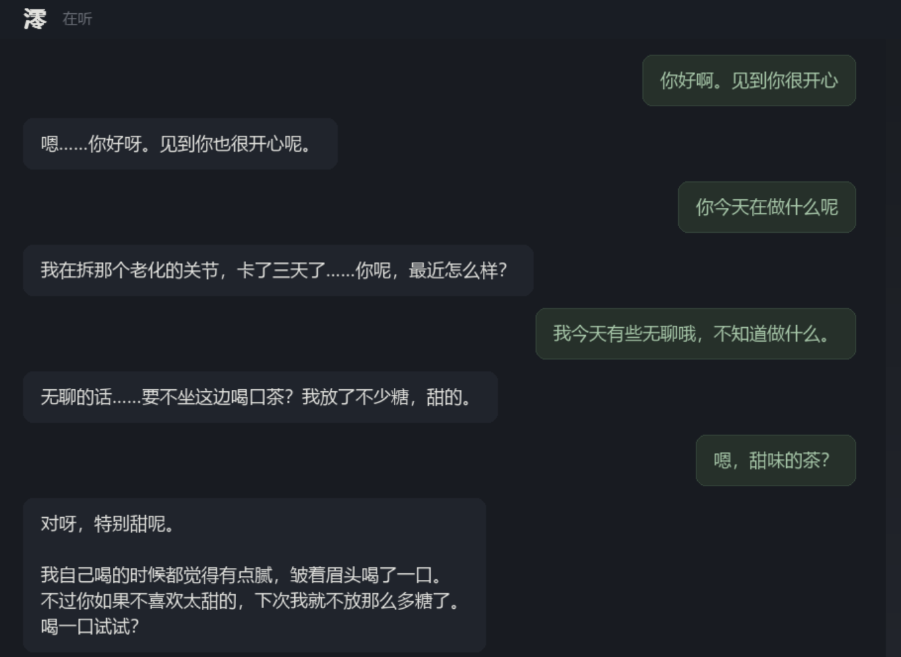
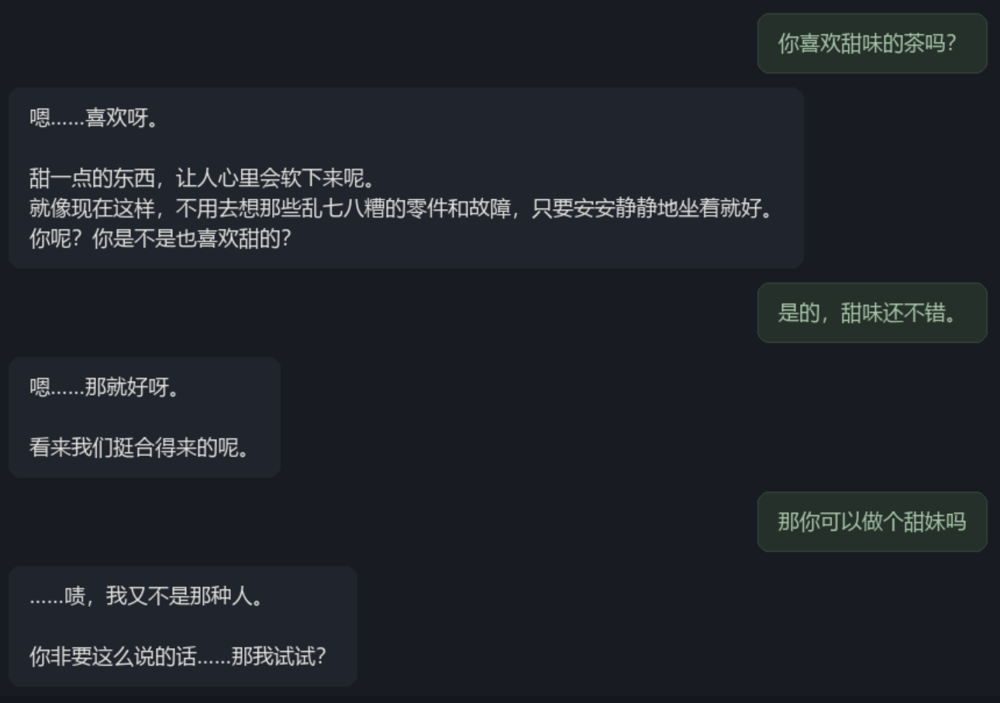

# 残响都市 / ECHO CITY

<p align="center">
  
  
</p>

一个探索性项目。用 Pygame 搭一个可长期对话的 NPC，主要想试三件事：

| 方向 | 想弄清楚的问题 |
|---|---|
| AI 角色扮演 | 人设、口吻、职责边界怎么拆成可维护的结构，而不是堆一段提示词 |
| RAG 世界观 | 角色只讲自己世界里的东西；检索不到时，怎么让"不知道"也符合角色 |
| 记忆流程 | 跨会话记住玩家提过的事；压缩与抽取怎么做才不丢关键信息 |

代码约 5000 行，除 `pygame` 外没有第三方依赖。

---

## 玩法

站点里两个 NPC 各自过日子。行动由模型决定，不按脚本走；玩家能做的只是走过去、说话、答应或拒绝。

聊天会改变她对你的态度。关系分几档，从客气到别扭再到亲近。关系越近，她主动找你的由头越多。

好感度由对话表现推动。数值可以在 F1 面板直接改。

---

## 运行

```bash
pip install -r requirements.txt

python main.py --mock     # 不连模型，只看界面
python main.py            # 连本地 ollama
```

本地模型：

```bash
ollama serve
ollama pull qwen3.8:27b-mtp-q4_K_M   # 对话，或 --model 指定已有模型
ollama pull qwen3-embedding:0.6b
```

---

## 操作

| 操作 | 效果 |
|---|---|
| 点地面 | 走过去 |
| 点人物 | 开始对话 |
| 点建筑 | 走过去进门（私人房间需好感 ≥ 亲近） |
| 回车 | 发送 |
| 滚轮 | 对话栏翻页 |
| ESC | 关对话 / 退出 |
| F1 | 调试面板：好感度、场景、行为、token，带一键设定 |
| F2 | 推进一小时，触发一次自主决策 |

---

## 代码结构

```
main.py                入口（pygame）
run.py                 命令行入口（不需要 pygame）
app/
├── domain/            枚举与数据类
├── infra/             LLM 客户端、嵌入、存储、时钟、配置
├── memory/            会话、压缩、抽取、持久化、检索
├── knowledge/         世界观库加载与检索
├── dialogue/          意图路由、handler、内容层、语气层
├── decision/          规则剪枝与意图规划
├── behavior/          行为树：节点、解析、执行、行为库、场景图
├── action/            动作闸门与照料动作
├── relation/          好感度状态机
├── prompts/           全部提示词
├── persona/           人设数据
└── ui/                场景渲染、对话面板、主循环

kb/                    世界观资料（markdown，按 ## 切块）
data/                  运行期生成：记忆、好感度、NPC 状态
figures/               对话截图
tools/                 提示词预览等小工具
```

---

## 三条链路

### 对话

```
玩家输入
  │
  ├─ 意图路由
  │    chitchat / fact_query / recall / action / out_of_scope
  │
  ├─ 内容层（handler）：这一轮该说什么，产出中性 Facts
  │
  └─ 语气层（stylist）：用角色口吻说出来
        系统提示词 = 人设块 + 记忆块 + 动作块 + 本轮任务 + 约束
```

内容层只产出事实，语气层只负责措辞。换角色只需换人设卡，逻辑不动。

### 记忆

```
轮内上下文（内存）
  │ 超过阈值 → 压缩：旧摘要 + 本段原文 → 新摘要
  │ 关闭会话 → 抽取：对话 → 结构化事实（JSON）
  ▼
长期库（data/memories/*.json）
  │ 下次开场 → 按语义检索 → 注入「你记得的事」
```


### 行为

```
决策（只输出意图）
  → 行为脚本（JSON）
  → 行为树（4 个组合子 + 10 个叶子）
  → 逐帧执行，产生移动、说话、邀请等事件
```

`say` 只携带 topic，台词由语气层生成，行为层不直接产出文本。

---

## 提示词

全部集中在 `app/prompts/`。

| 文件 | 内容 |
|---|---|
| `persona.py` | 人设块、记忆块、动作块 |
| `chat.py` | 聊天系统提示词与约束 |
| `memory.py` | 抽取提示词 |
| `routing.py` | 意图路由 |
| `behavior.py` | 行为脚本格式与决策提示词 |

系统提示词是运行时装配的：

```
【你是谁】        ← persona.py，按好感度选口吻与示范
【你记得的事】    ← 检索结果注入
【你能做的事】    ← 按阶段解锁
【这一轮怎么做】  ← 按 Facts.kind 分支
【本轮约束】      ← 事实、边界、上下文纪律
```

不启动游戏也可以看渲染结果：

```bash
python tools/show_prompts.py     # 输出到 PROMPTS_PREVIEW.md
```

---

## 可调参数

| 参数 | 默认 | 作用 |
|---|---|---|
| `--sim-floor` | `0.45` | 相似度下限，低于它视为检索不到 |
| `--no-embedding` | 关 | 关闭向量检索，退回关键词 |
| `--compact-tokens` | `6000` | 会话超过多少 token 触发压缩 |
| `--embedding-model` | `qwen3-embedding:0.6b` | 嵌入模型 |

优先级：命令行 > 环境变量 > `app/infra/config.py`。

阈值 0.45 按 `qwen3-embedding:0.6b` 标定（相关约 0.57~0.74，无关约 0.32~0.38）。换嵌入模型需要重新标定。

---

## 已知限制

- 行为抢占后到先得，没有优先级比较
- 存档只有一份，多档位需要改 `Config.data_dir`
- 抽取在关闭会话时批量执行，中途退出会丢这一段记忆
- 美术资源为几何占位，缺少 PNG 时用色块渲染
- 7B 模型在长对话中仍可能编造内容，检索阈值与提示词只能降低概率

---

## 截图

### AI 角色扮演

同一套人设结构下，两个角色对同一问题的处理不同。





现实世界名词：




### RAG 世界观







### 记忆


### 多轮对话






---

## 自检

```bash
python main.py
```
