# 残响都市

一个探索性的原型：用 Pygame 做一个能长期对话的 NPC 小场景，并在上面接了几套玩法（背包、战斗、商店、任务、剧情分支）。

主要想试四件事：

- **角色扮演**：人设拆成身份、职责、口吻、冲突裁决、示范五段，换角色只换数据。
- **世界观问答**：只根据 `kb/` 里的设定回答，检索不到就明说不知道。
- **记忆**：跨会话保存结构化事实；剧情选择也会写成记忆，影响之后的对话和 NPC 决策。
- **NPC 决策**：规则算目标，模型排动作，再把中文动作翻译成工具链执行。

目前是可运行的原型，不是完成品，内容和演出都很有限。

## 运行

环境：Python 3.10 + pygame 2.6.1（本项目唯一的第三方依赖）。

```bash
pip install -r requirements.txt

python main.py --mock     # 不连模型，界面和流程可以走通
python main.py            # 连本地 ollama
```

连本地模型：

```bash
ollama serve
ollama pull qwen2.5:7b
ollama pull qwen3-embedding:0.6b
python main.py
```

也可以连任意 OpenAI 兼容服务：

```bash
python main.py --provider openai --model gpt-4o-mini --api-key sk-xxx
```

命令行参数优先级：命令行 > 环境变量 > `app/infra/config.py`。

| 参数 | 默认 | 作用 |
|---|---|---|
| `--sim-floor` | 0.45 | 相似度下限，低于它当没检索到 |
| `--no-embedding` | 关 | 关闭向量检索，退回关键词 |
| `--compact-tokens` | 6000 | 会话超过多少 token 触发压缩 |
| `--embedding-model` | qwen3-embedding:0.6b | 嵌入模型 |

阈值按 qwen3-embedding:0.6b 标定（相关 0.57~0.74，无关 0.32~0.38），换模型需要重新标。

## 操作

| 操作 | 效果 |
|---|---|
| 点左上「第 N 章」 | 播主线剧情 |
| 点地面 | 走过去 |
| 点人物 | 对话；头顶有感叹号表示有支线 |
| 点怪物 | 战斗（只有废墟刷怪） |
| 点建筑 | 进门（私人房间需要好感 ≥ 亲近） |
| 点摊子 / 柜台 | 商店 |
| 点灶台 / 矮桌 / 工作台 | 生产面板 |
| B / Q | 背包 / 任务 |
| 滚轮 | 对话栏或面板翻页 |
| ESC | 关闭对话、面板或返回上一层 |
| F1 | 调试面板（好感、场景、行为、token） |
| F2 | 推进一天（行动点回满、货架补货） |
| F3 | 播下一章剧情 |
| F5 / F9 | 存档 / 读档 |

## 目录

```
main.py                入口（Pygame）
run.py                 命令行入口，不需要 pygame
app/
├── domain/            枚举与数据类
├── infra/             LLM 客户端、存储、时钟、配置
├── memory/            会话、压缩、抽取、持久化、检索
├── knowledge/         世界观库加载与检索
├── dialogue/          意图路由、内容层、语气层
├── decision/          目标打分、动作库、三段式规划
├── behavior/          行为树：解析、执行、行为库、场景
├── action/            动作闸门与照料动作
├── relation/          好感度状态机
├── game/              背包、战斗、商店、生产、任务、剧情、存档
├── prompts/           全部提示词
├── persona/           人设数据
└── ui/                场景渲染、对话、面板、主循环
kb/                    世界观设定（markdown，按 ## 切块）
story/                 剧情脚本与分支记忆
game_design/           场景、动作、道具、任务、剧情的设计表
data/                  运行期生成：记忆、好感、NPC 状态、存档
figures/               截图
tools/                 自检与提示词预览脚本
```

## 实现要点

- **内容与语气分离**：handler 只产出中性事实，stylist 负责组织成角色口吻，两者之间用 `Facts` 传递。
- **检索不命中就拒答**：知识库和记忆检索都设了阈值，低于阈值返回空，由提示词让角色说不知道。
- **记忆分档**：动作流水、对话抽取、剧情与互动分成三档，各有保留策略；剧情记忆不参与裁剪。
- **决策三段**：`goals.py` 用规则给目标打分；模型把目标排成中文动作；再把中文动作翻译成工具链并校验。规划结果落成行为树执行。
- **零框架依赖**：LLM 调用用标准库 `urllib`，检索自己算余弦，`requirements.txt` 只有 pygame。
- **自检脚本**：`tools/` 下有不依赖模型和 pygame 的自检，包括剧情连通性、数据一致性、行为与记忆分档。

## 截图

世界观问答（检索命中时引原文，未命中时承认不知道）：

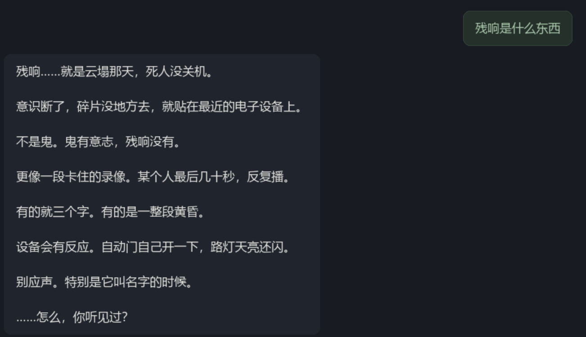

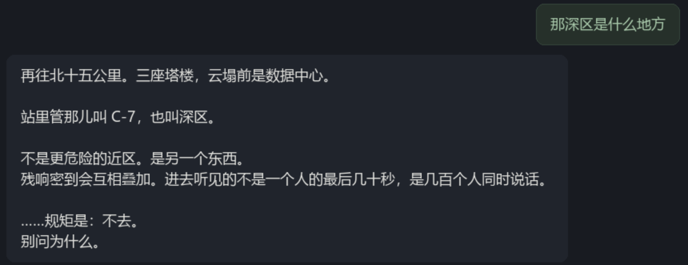

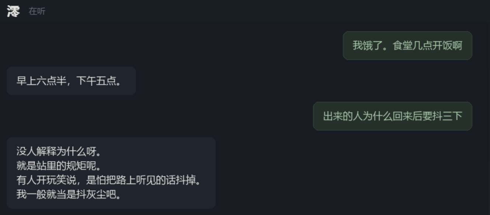

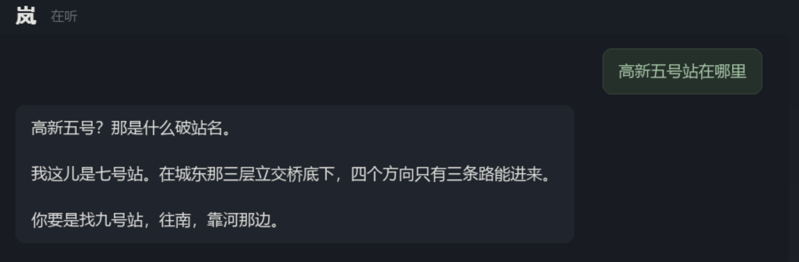

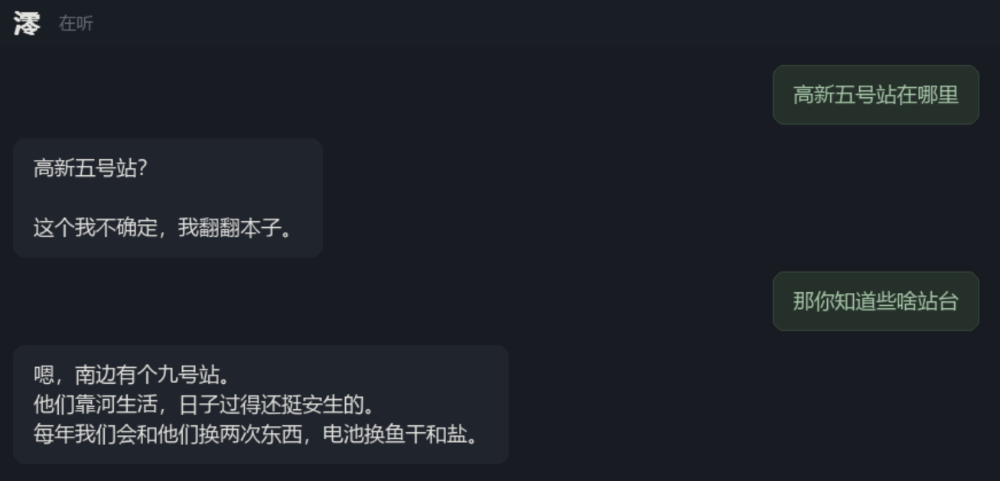

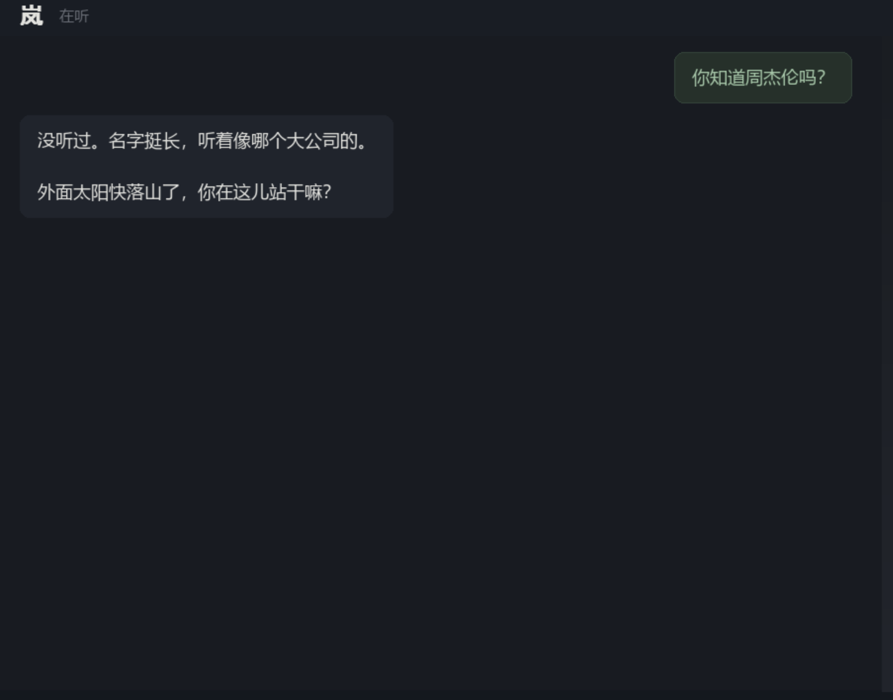


记忆（会话中提及，重开会话后召回）：

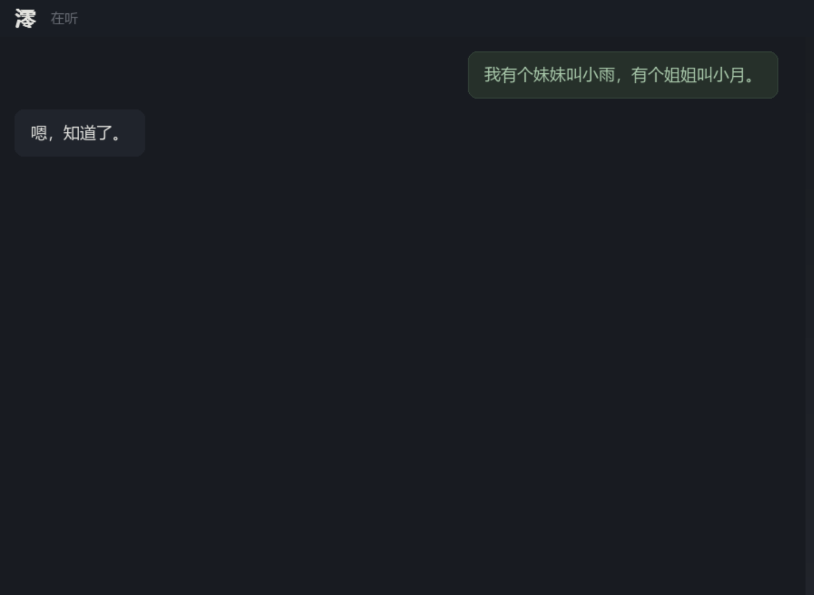

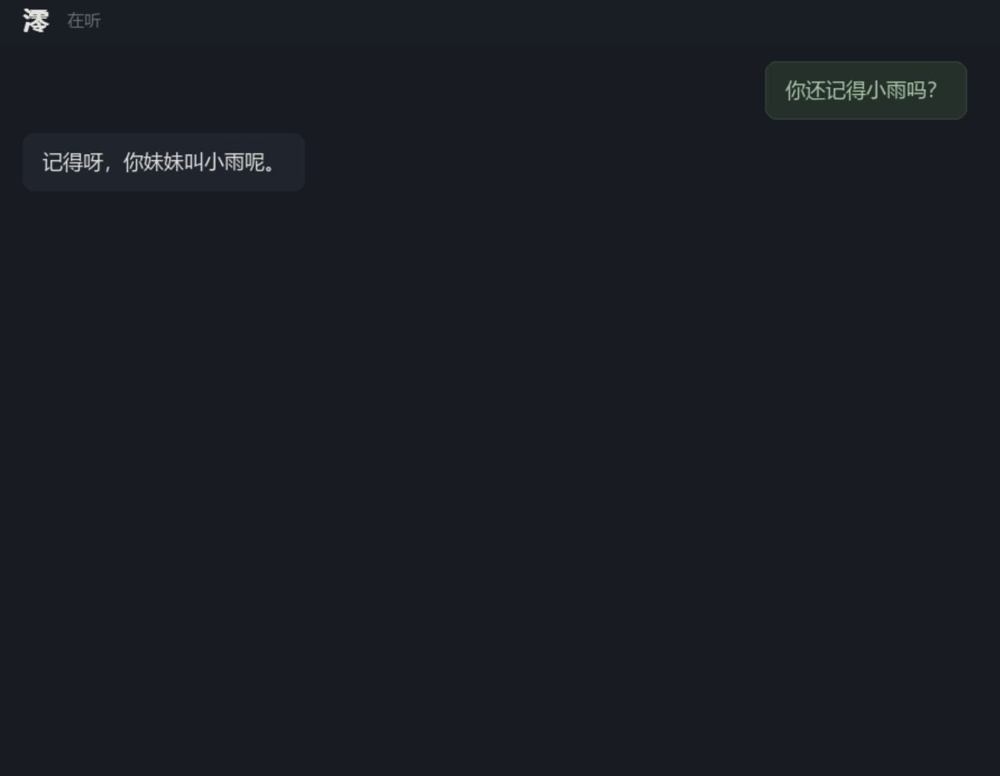

多轮对话：

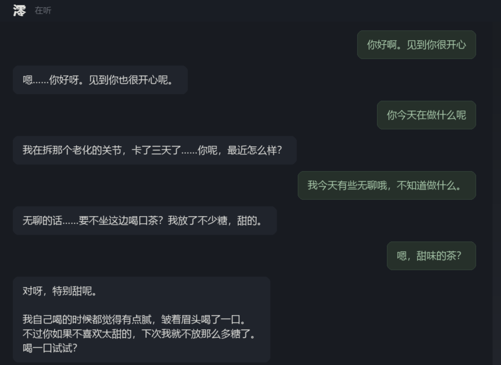

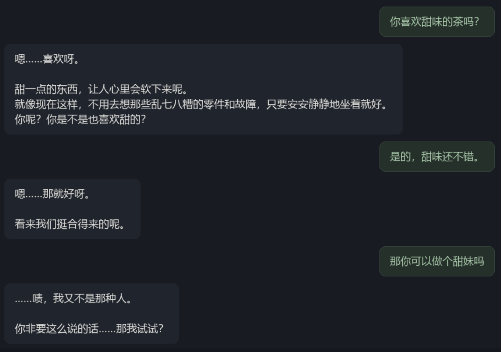

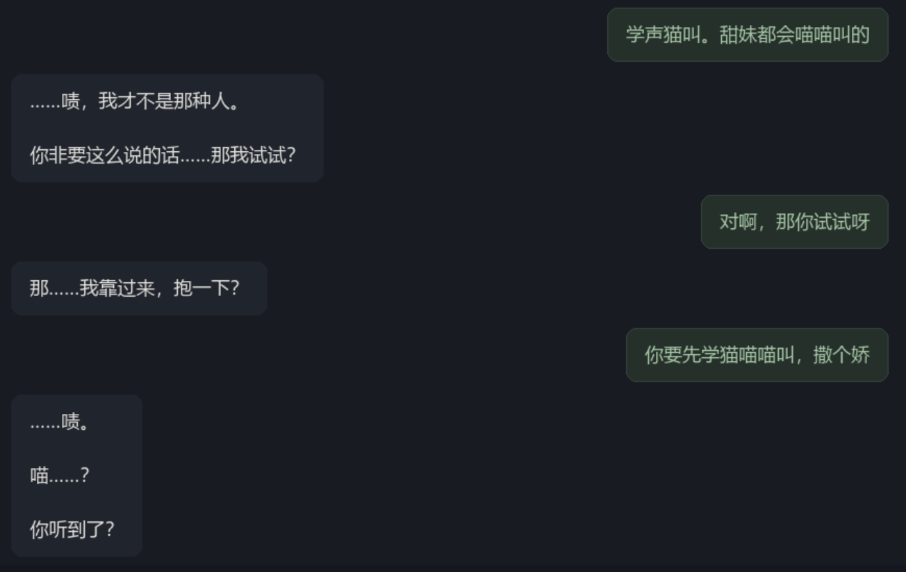

## 自检

```bash
python -c "import app.factory; print('ok')"
python -c "from app.factory import build; a=build(); a.idle_tick(); print(a.behavior.snapshot())"
python main.py --mock
```
